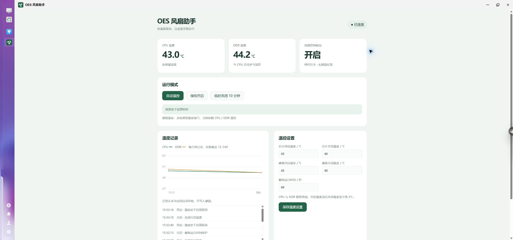
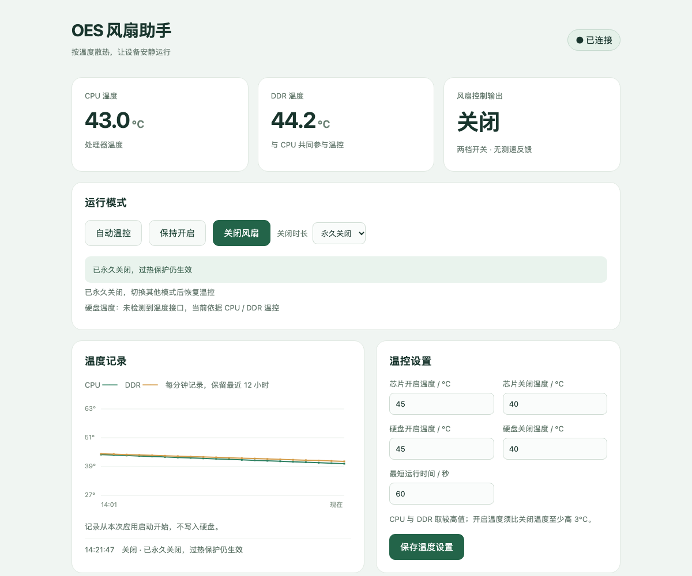

# OES 风扇助手 1.0.3

已在本机 OneThing Cloud OES（A311D，ARM64，内核 6.18.18.c1151-trim）安装并测试 1.0.1 基线。1.0.2 增加定时/永久关闭，1.0.3 增加常开间歇调速（转速 0–100%、占空周期 0.1–10 秒可调）；两项新功能均已通过本地策略与控制器测试，尚未实机复测。

## 打开与使用

使用飞牛管理员账号登录 `http://<NAS地址>:5666/`，双击桌面的 **OES 风扇助手**。

- **自动温控**：CPU 与 DDR 取较高温度；默认达到 45℃开启，两者都降到 40℃及以下才关闭。默认最短运行 60 秒，避免频繁启停。
- **保持开启**：风扇持续开启，可用 0%–100% 滑动条设置常开转速，并用 0.1–10 秒滑动条设置占空周期。100% 为持续开启；1%–99% 在所选周期内按通电占比近似平均风量，会周期性启停；0% 为常开模式下停转，过热保护仍会强制开启。周期越短启停越频繁，且受 10ms 调度限制，0.1 秒周期只有约 10% 的转速档位；低转速可能无法起转。
- **关闭风扇**：可选择 10 分钟、30 分钟、1 小时或永久关闭。定时关闭到点后回到自动模式，应用重启也会取消定时关闭；永久关闭会保留到手动切换模式，过热保护仍然生效。
- **保护始终生效**：芯片温度达到 65℃、已检测到的硬盘温度达到 55℃，或芯片温度读取异常时强制开启。过热保护带 5℃迟滞。
- 温控阈值可以直接在网页修改。开启温度须至少高于关闭温度 3℃。

此设备的设备树只有两档开关。页面提供常开间歇调速；百分比是所选周期（默认 1 秒，可调 0.1–10 秒）内的平均通电时间，不是真实 PWM，也不是实测转速。周期越短启停越频繁，可能产生明显噪音或抖动；低占空比时风扇可能来不及起转。底层每 10ms 调度一次，0.1 秒周期只有约 10% 的转速档位，要保留 1% 档位请使用 1 秒或更长周期。驱动曾显示的 3000 不是实测转速。应用验证 GPIO 输出回读，无法验证风扇叶片是否实际旋转。

当前未检测到硬盘温度接口，因此当前运行依据 CPU / DDR 温度；界面会明确提示。未来若系统提供 drivetemp 或 NVMe hwmon 温度接口，将自动纳入温控，不主动唤醒硬盘。

## 停止、卸载与恢复

通过飞牛应用中心停止应用，会释放应用持有的风扇 GPIO、重新绑定原 gpio-fan 驱动，并恢复启动前处于运行状态的系统风扇服务。不更改系统服务的开机启用设置，也不关闭 CPU 的内核降频保护。

应用安装两个专属 systemd 服务：`oes-fan-hardware.service` 和 `oes-fan-web.service`。硬件进程意外退出时，systemd 先执行恢复，再尝试重启应用控制。卸载会移除这两个专属服务。

未执行整机重启测试，未通过加热机器测试真实过热；过热阈值逻辑已通过模拟输入的边界测试。

## 权限与数据

网页服务监听本地 Unix Socket，启动后降权为应用用户，不开放额外 TCP 端口。访问须通过飞牛网关管理员身份校验；写操作另有 CSRF 校验。特权服务仅允许 root 或本应用 UID 通过本地 Socket 请求固定操作。

本应用的特权服务源码由 root 持有，启动时清除默认的包用户写入 ACL。用户设置保存在应用数据目录，界面温度历史保留最近 720 个分钟采样点，仅存于内存。

本地开发使用 uv 虚拟环境。目标机器未安装 uv，因此运行时通过系统 Python 标准库创建无第三方依赖的独立虚拟环境。

## 测试记录（1.0.1 基线）

- 设备树核对：风扇 GPIO phandle 对应 `/dev/gpiochip0`，line 45，极性为高电平有效；无猜测引脚回退。
- 短时实机开关：开启、关闭 3 秒、重新开启，输出回读一致；结束后恢复原驱动及系统服务。
- 网页操作：飞牛桌面启动、状态显示、三种模式切换成功，最终恢复自动模式。
- 接口保护：无管理员身份返回 403；缺少 CSRF 返回 403；非法温度配置返回 400 且不改变原配置。
- 温控决策：传感器异常、过热开启与迟滞、最短运行时间、配置上下限测试通过。
- 故障恢复：强制终止硬件主进程后，日志确认原驱动与系统服务恢复，随后新进程重新接管。
- 应用中心：停止后系统原服务恢复；卸载后专属服务移除；最终 FPK 重新安装后显示 1.0.1 且运行正常。
- 安装后的四个 Python 源文件 SHA-256 与交付源码一致。

1.0.2 的定时/永久关闭已通过 `tools/test_policy.py` 与 `tools/test_controller.py` 本地测试，覆盖到点恢复、永久关闭跨应用重启保留、过热保护仍强制开启、非法时长拒绝；`tools/verify_installed.py` 已扩展对应接口校验，安装到设备后需再执行一次实机验证。

1.0.3 的常开间歇调速（0–100% 转速、0.1–10 秒周期）已通过 `tools/test_policy.py` 与 `tools/test_controller.py` 本地测试，覆盖 0%/60%/100% 占空比、周期边界与相位切换、过热保护强制全速、非法速度/周期拒绝；`tools/verify_installed.py` 已扩展常开调速接口校验，安装到设备后同样需实机执行。

## 构建

当前仓库根目录就是 FPK 项目目录。使用飞牛官方 fnpack 1.2.3：

```text
fnpack build --directory .
```

没有 fnpack 的机器可运行 `python3 tools/build_local.py`，生成目录结构和 `md5(app.tgz)` 校验和一致的 FPK；正式发布仍建议使用官方 fnpack。本次交付的 FPK 不包含 SSH 密钥、测试脚本、缓存或虚拟环境。

## 发布

推送 `v*` 标签（例如 `v1.0.3`）会触发 [release.yml](.github/workflows/release.yml)：

1. 校验标签版本与 `manifest` 的 `version` 一致；
2. 运行策略与控制器测试；
3. 下载官方 fnpack 1.2.3 并构建 FPK；
4. 生成 `SHA256SUMS`，创建 GitHub Release 并上传 FPK 与校验和。

标签版本必须与 `manifest` 一致，否则工作流会失败。发布示例：

```text
git tag v1.0.3
git push origin v1.0.3
```


## 运行界面

1.0.1 实机界面：



1.0.2 界面示意（模拟数据，永久关闭状态）：



1.0.3 界面示意（模拟数据，常开 60%、周期 1.0 秒）：


1.0.3 在“保持开启”卡片内增加 0%–100% 常开转速滑动条和 0.1–10 秒占空周期滑动条，并在周期变化时提示当前转速档位精度。
