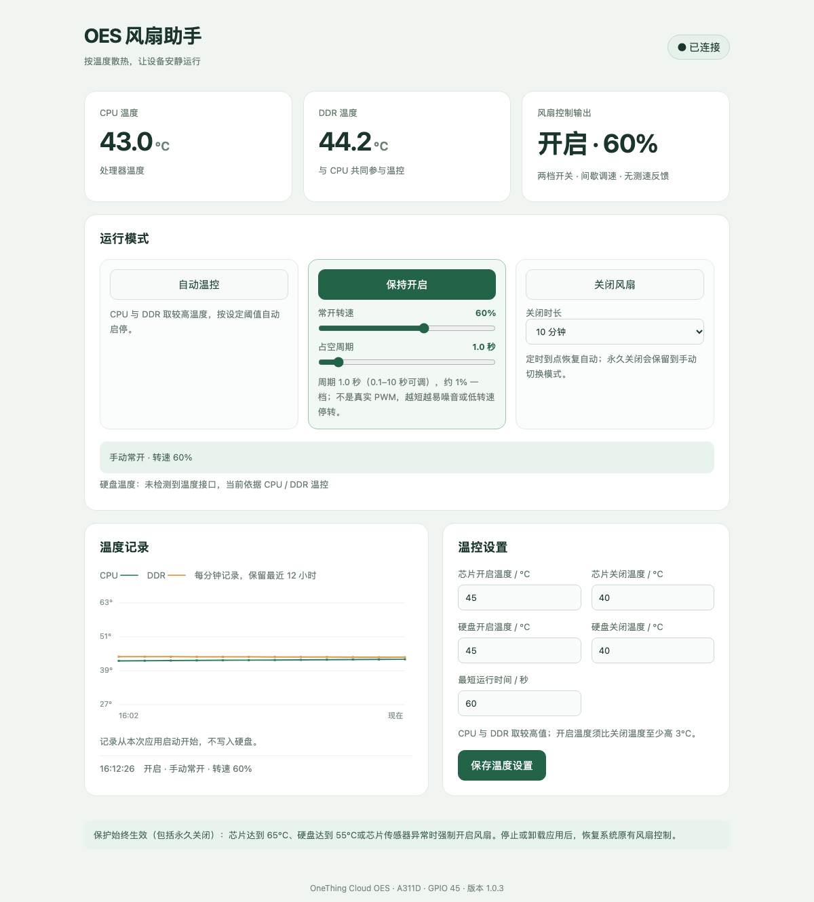

# OES 风扇助手 1.0.3

OneThing Cloud OES 的风扇控制应用：自动温控、常开调速、定时/永久关闭和过热保护。1.0.1 基线已实机验证；1.0.2/1.0.3 新功能通过本地测试，尚未实机复测。

## 使用

飞牛管理员登录 `http://<NAS地址>:5666/`，打开桌面的 **OES 风扇助手**。

- **自动温控**：CPU 与 DDR 取较高温度；默认 45℃ 开启、40℃ 关闭，最短运行 60 秒。阈值可改，开启温度须至少比关闭温度高 3℃。
- **保持开启**：0%–100% 调速，占空周期 0.1–10 秒。100% 持续开启；0% 停转；中间值按周期通断。周期越短档位越粗、噪音越明显，低转速可能无法起转。
- **关闭风扇**：可选 10 分钟、30 分钟、1 小时或永久关闭。定时到点或应用重启后恢复自动；永久关闭保留到手动切换。
- **过热保护**：芯片达到 65℃、已检测到的硬盘达到 55℃，或传感器异常时强制开启，带 5℃ 迟滞；永久关闭时仍生效。

设备是两态 GPIO 风扇，没有真实 PWM 和测速。百分比是所选周期内的通电占比，不是实际转速；0.1 秒周期只有约 10% 的转速档位，1 秒及以上约 1%。GPIO 回读正常不代表叶片一定旋转。当前未检测到硬盘温度接口，暂按 CPU / DDR 温控。

## 停止与卸载

在飞牛应用中心停止应用，会释放风扇 GPIO、恢复原 gpio-fan 驱动和原有风扇服务；卸载还会移除 `oes-fan-hardware.service` 和 `oes-fan-web.service`。未做整机重启和真实加热测试。

## 安全与数据

Web 服务只监听本地 Unix Socket，不开放额外 TCP 端口；访问需飞牛管理员身份，写操作另有 CSRF 校验。特权服务仅接受 root 或本应用 UID 的本地请求。设置保存在应用数据目录，温度历史仅存内存，约保留 12 小时。

## 验证

`tools/test_policy.py` 与 `tools/test_controller.py` 覆盖温控、关闭、调速和周期边界；`tools/verify_installed.py` 需在设备上执行。1.0.1 已完成实机安装、开关、接口保护、故障恢复及停止/卸载测试；1.0.2/1.0.3 尚未实机复测。

## 构建与发布

```text
fnpack build --directory .
```

没有 fnpack 时可用 `python3 tools/build_local.py`。推送 `v*` 标签会触发 [release.yml](.github/workflows/release.yml)：校验 `manifest` 版本、运行测试、使用 fnpack 1.2.3 构建 FPK，并发布 FPK 与 `SHA256SUMS`。标签版本必须与 `manifest` 一致。

## 界面


